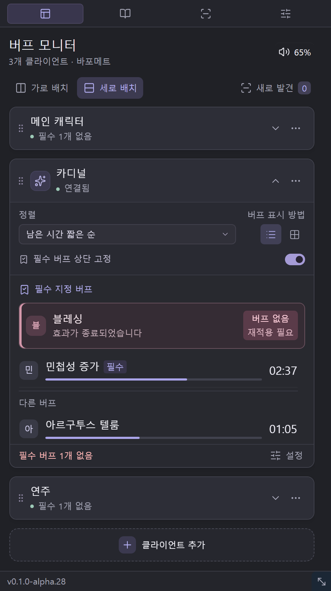
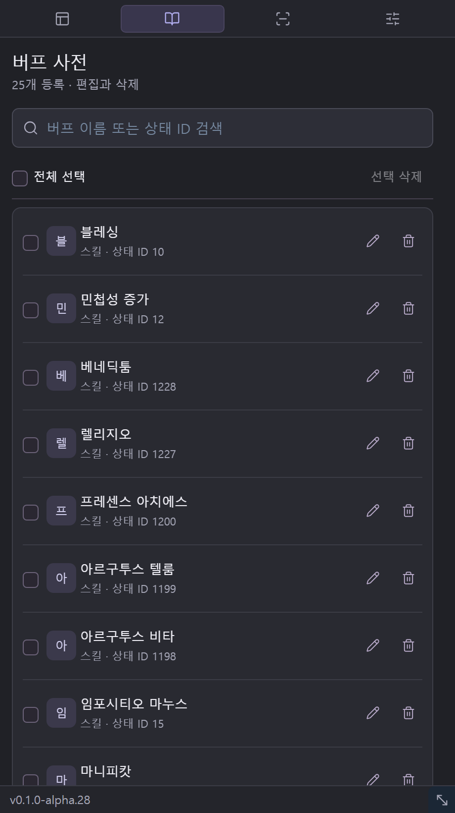
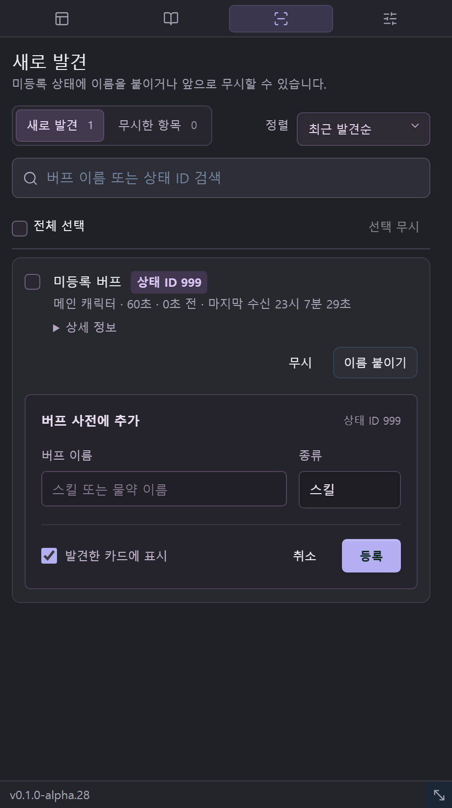

# RO CLOUD BUFF

라그나로크 온라인을 위한 Windows용 버프 알리미입니다. 여러 캐릭터의 버프 상태와 남은 시간을 한 화면에서 확인하고, 놓치기 쉬운 버프를 관리할 수 있습니다.

현재 **한국 공식 라그나로크 온라인에서 테스트 중인 알파 버전**입니다.

## 화면 미리보기

실제 alpha.28 UI에 설명용 예시 데이터를 넣어 촬영한 화면입니다. 버프 이름·남은 시간·미등록 ID는 사용 예시입니다.

| 버프 모니터 | 버프 사전 | 새로 발견 |
|:---:|:---:|:---:|
|  |  |  |

## 주요 기능

- 여러 클라이언트를 카드로 관리하고 순서 변경·접기·펼치기
- 클라이언트 카드의 가로·세로 배치
- 버프의 목록·그리드 표시
- 남은 시간 또는 적용·갱신 순서에 따른 정렬
- 필수 지정 버프의 상단 고정과 버프 없음 표시
- 버프 종료 임박·종료 소리 알림 및 음량 조절
- 새로 감지한 상태의 ID 확인, 이름 등록 및 무시
- 버프 사전과 클라이언트 구성을 코드로 공유
- 항상 위에 표시 및 화면 가장자리 자석 기능

클라이언트 카드 수에는 별도 제한을 두지 않습니다.

## 실행 전 준비

[Npcap 공식 다운로드](https://npcap.com/#download)에서 **Npcap Installer**를 내려받아 설치해주세요. SDK는 필요하지 않습니다.

Npcap은 Windows에서 네트워크 통신 데이터(패킷)를 읽을 수 있게 해주는 드라이버와 라이브러리입니다. RO CLOUD BUFF는 이를 이용해 게임에서 수신하는 버프 정보를 감지합니다. Npcap은 배포 ZIP에 포함하지 않으므로 별도로 설치해야 합니다.

Windows 11의 일반적인 환경에서는 Npcap만 별도로 설치하면 됩니다. .NET 런타임은 배포본에 포함됩니다. WebView2 Runtime이 제거되었거나 정상적으로 동작하지 않는 환경에서는 해당 런타임도 설치·복구해야 합니다.

다운로드 사이트에 인증서 경고가 나타나면 경고를 우회하지 말고 인증서가 정상화된 뒤 이용해주세요.

## 실행 방법

[Releases](https://github.com/hypermix/RO-Cloud-Buff/releases)에서 최신 배포 ZIP을 내려받을 수 있습니다.

1. 배포 ZIP의 압축을 풉니다.
2. `ROCloudBuff.exe`를 실행합니다.
3. 실행파일 옆의 `Web` 폴더는 함께 유지해주세요.

기준 운영체제는 Windows 11입니다.

## 게임 창 연결

1. 게임에 접속한 뒤 카드에서 **창 연결**을 누릅니다.
2. 게임 창 목록이나 과녁 기능으로 연결할 창을 지정합니다.
3. 해당 캐릭터에게 버프를 새로 적용하거나 기존 버프를 갱신합니다.
4. 감지한 내용이 맞는지 확인하고 **연결 완료**를 누릅니다.

프로그램을 다시 실행하면 게임 창 연결과 본인 확인을 다시 진행해야 합니다.

## 버프 관리

기본 클라이언트는 **메인 캐릭터·카디널·연주**로 구성됩니다. 사용 목적에 맞게 이름과 표시할 버프를 변경하거나 카드를 추가할 수 있습니다.

사전에 없는 상태가 감지되면 **새로 발견**에 표시됩니다. 상태 ID와 감지 정보를 확인한 뒤 이름을 붙여 사전에 등록하거나 무시할 수 있습니다. 무시한 항목은 별도 탭에서 복구할 수 있습니다.

## 설정 보관과 업데이트

설정은 실행파일과 별도로 다음 경로에 저장됩니다.

```text
%LOCALAPPDATA%\ROCloudBuff\settings.db
```

버프 사전, 클라이언트 구성, 표시·알림 설정 등을 보관합니다. 같은 PC와 Windows 계정에서는 새 버전을 다른 폴더에 풀어 실행해도 기존 설정을 사용합니다.

이전 설정 폴더 `RO CLOUD BUFF`의 데이터가 있으면 새 경로에 설정이 없는 경우 자동으로 가져오며 원본은 보존합니다.

### 다른 PC로 이전하거나 공유하기

- **전체 이전:** 프로그램을 종료한 상태에서 설정 DB를 백업한 뒤 대상 PC의 같은 설정 경로에 복사합니다.
- **구성 공유:** 환경설정의 **코드 만들기 / 코드 가져오기**를 사용합니다.

설정 코드를 가져올 때:

- 버프 사전은 상태 ID를 기준으로 기존 값 유지 또는 가져온 값으로 교체를 선택합니다.
- 클라이언트는 이름이 같아도 항상 새 카드로 추가합니다. 같은 코드를 다시 가져오면 카드가 다시 추가됩니다.
- 실행 중인 게임 창 연결과 버프 남은 시간은 공유하지 않습니다.
- 일반 환경설정과 새로 발견·무시 기록은 설정 코드에 포함하지 않습니다.

alpha.28부터 공백 없는 설정 경로, 클라이언트 수 제한 해제와 항상 새 카드로 가져오기가 적용됩니다.

## 개발 및 빌드

필요한 도구:

- .NET 10 SDK
- Python 3

저장소 루트에서 실행합니다.

```powershell
python build-ui.py

dotnet publish src/RoCloudBuff.csproj `
  -c Release `
  -r win-x64 `
  --self-contained true `
  -p:PublishSingleFile=true `
  -p:IncludeNativeLibrariesForSelfExtract=true `
  -o artifacts/publish
```

빌드 결과는 `artifacts/publish/`에 생성됩니다. 실행파일과 `Web` 폴더를 함께 배포해야 합니다. 배포 시 README와 외부 구성요소의 라이선스·고지 파일도 함께 포함해주세요.

### 소스 구성

| 경로 | 내용 |
|---|---|
| `src/` | WPF 호스트, 게임 창 연결, 캡처 및 UI |
| `src/RoBuff.Core/` | 프로토콜 해석, 버프 추적 및 저장 |
| `src/Web/` | WebView UI |
| `design-source.html` | UI 생성 원본 |
| `build-ui.py` | UI 생성 스크립트 |
| `default-presets.json` | 기본 버프 사전과 클라이언트 구성 |

빌드 결과물, 사용자 설정 DB, 패킷 캡처 및 로그는 Git 추적에서 제외합니다. 프로젝트에서 만드는 폴더·파일명에는 공백을 사용하지 않습니다.

## 버그 제보

[Issues](https://github.com/hypermix/RO-Cloud-Buff/issues)에 아래 내용을 함께 남겨주세요.

- 프로그램 버전
- 문제 발생 상황과 재현 순서
- 관련 버프 이름과 상태 ID
- 필요한 경우 화면 캡처

설정 코드나 캡처 자료를 첨부할 때는 캐릭터 이름 등 공개하고 싶지 않은 정보가 포함되어 있는지 확인해주세요.

## 제작

**라그나로크 온라인 · 바포메트 · 구름장수**

## 라이선스

이 프로젝트는 [MIT 라이선스](LICENSE)로 배포됩니다. 저작권 및 라이선스 고지를 유지하면 사용·수정·재배포·상업적 이용이 가능합니다.

외부 구성요소에는 각각의 라이선스가 적용됩니다. [THIRD_PARTY_NOTICES.md](THIRD_PARTY_NOTICES.md)를 참고해주세요.
